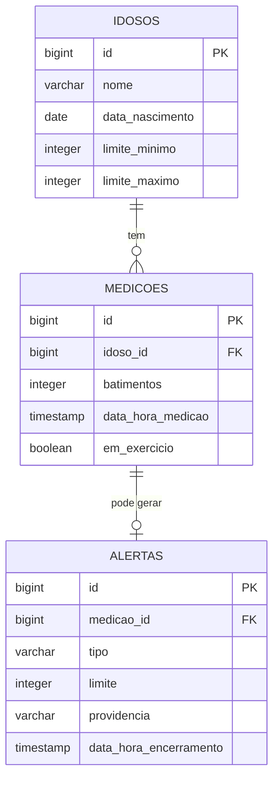

# Modelo de domínio

## Entidades

### Idoso

Uma pessoa acompanhada pelo sistema, com os seus limites de batimento.

| Atributo | Tipo Java | Coluna | Obrigatório | Regra |
|---|---|---|---|---|
| `id` | `Long` | `id` | sim | Gerado pelo banco |
| `nome` | `String` | `nome` | sim | Até 100 caracteres |
| `dataNascimento` | `LocalDate` | `data_nascimento` | sim | Precisa estar no passado. Usada para calcular a idade na R2 |
| `limiteMinimo` | `Integer` | `limite_minimo` | sim | Maior que zero. Se o cliente não mandar, a API usa 60 (R1) |
| `limiteMaximo` | `Integer` | `limite_maximo` | sim | Maior que zero. Se o cliente não mandar, a API usa 100. Precisa ser maior que o mínimo (R1) |

### Medicao

Um batimento enviado pelo relógio de um idoso.

| Atributo | Tipo Java | Coluna | Obrigatório | Regra |
|---|---|---|---|---|
| `id` | `Long` | `id` | sim | Gerado pelo banco |
| `idoso` | `Idoso` | `idoso_id` | sim | O idoso precisa existir |
| `batimentos` | `Integer` | `batimentos` | sim | Batimentos por minuto, maior que zero |
| `dataHoraMedicao` | `LocalDateTime` | `data_hora_medicao` | sim | Não pode estar no futuro. Não se repete para o mesmo idoso (R3) |
| `emExercicio` | `Boolean` | `em_exercicio` | sim | Se `true`, o limite alto passa a ser 220 menos a idade (R2) |

### Alerta

O aviso de que uma medição saiu dos limites do idoso. Quem cria é a API, nunca o cliente.

| Atributo | Tipo Java | Coluna | Obrigatório | Regra |
|---|---|---|---|---|
| `id` | `Long` | `id` | sim | Gerado pelo banco |
| `medicao` | `Medicao` | `medicao_id` | sim | A medição que gerou o alerta. Única: uma medição gera no máximo um alerta |
| `tipo` | `String` | `tipo` | sim | `ALTO` (acima do limite máximo) ou `BAIXO` (abaixo do mínimo). A API decide (R1) |
| `limite` | `Integer` | `limite` | sim | O limite que a medição ultrapassou. Em exercício, o alto é 220 menos a idade (R2) |
| `providencia` | `String` | `providencia` | não | O que a família fez. Vazio enquanto o alerta está aberto; obrigatório para encerrar (R4) |
| `dataHoraEncerramento` | `LocalDateTime` | `data_hora_encerramento` | não | Vazio enquanto o alerta está aberto. A API preenche ao encerrar; preenchido, o alerta não encerra de novo (R4) |

## Relacionamentos

| De | Para | Tipo | No banco | No código |
|---|---|---|---|---|
| Medicao | Idoso | muitos para um | `medicoes.idoso_id` referencia `idosos(id)` | `@ManyToOne` em `Medicao` |
| Alerta | Medicao | um para um | `alertas.medicao_id` referencia `medicoes(id)`, com `UNIQUE` | `@OneToOne` em `Alerta` |

## Diagrama ER

Como ler: `||--o{` é "um para muitos": um idoso tem zero ou várias medições, e cada medição é de exatamente um idoso. `||--o|` é "um para zero ou um": uma medição gera no máximo um alerta (só quando sai dos limites), e cada alerta vem de exatamente uma medição.

## Migrations

Todas existem em `src/main/resources/db/migration`, uma tabela por arquivo. A ordem importa: a tabela referenciada nasce antes da que referencia.

| Versão | Arquivo | O que cria |
|---|---|---|
| V1 | `V1__criar_idosos.sql` | Tabela `idosos` |
| V2 | `V2__criar_medicoes.sql` | Tabela `medicoes`, com a chave estrangeira para `idosos` |
| V3 | `V3__criar_alertas.sql` | Tabela `alertas`, com a chave estrangeira única para `medicoes` |
